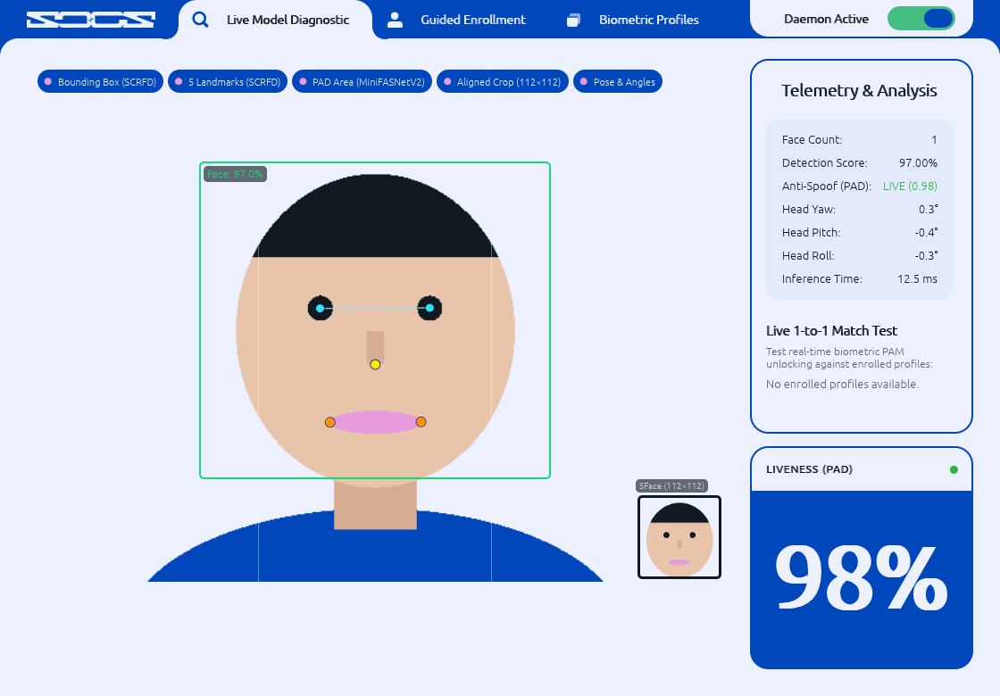
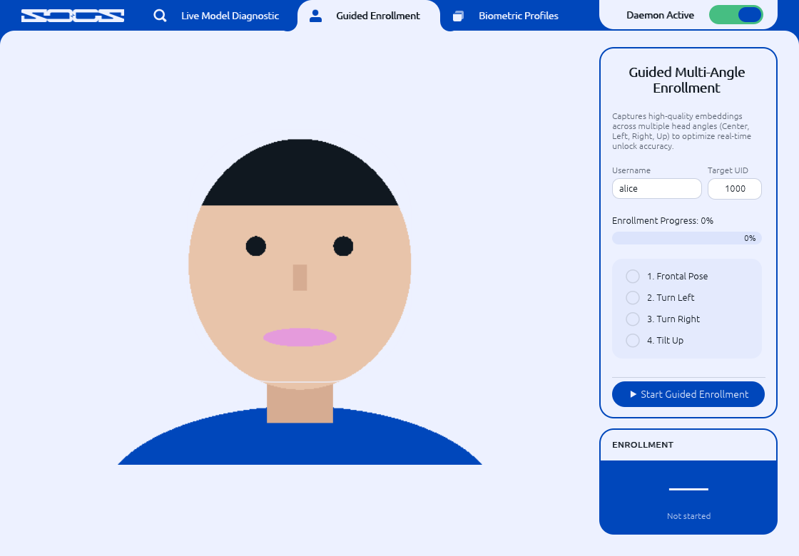
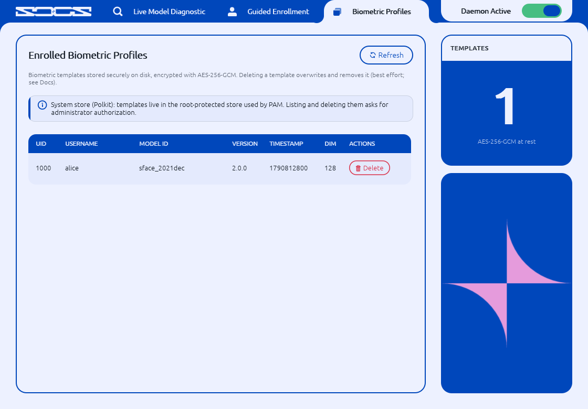
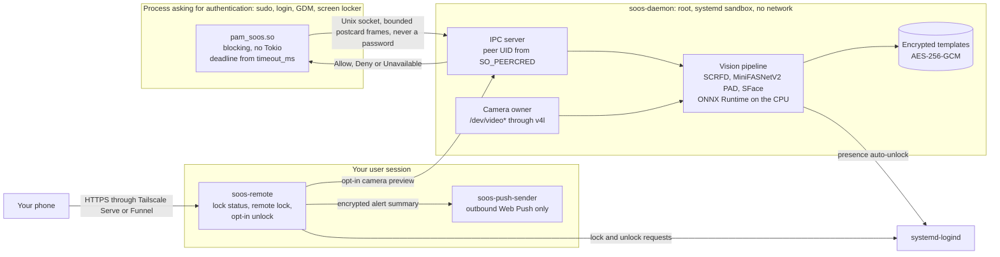

# soos

**Face unlock for Linux, local only, your password always works.**

soos is a PAM module and a root daemon that check your face with the camera of your PC. Face verification
runs entirely on your machine: the models run on the CPU, the daemon has no network access, and when anything
goes wrong the normal password prompt takes over.

[](https://github.com/soos-security/soos/actions/workflows/ci.yml)
[](https://github.com/soos-security/soos/actions/workflows/fuzz.yml)
[](LICENSE)
[](rust-toolchain.toml)
[](Docs/DISTRIBUTION_DEPLOYMENT.md)

<p align="center">
  
</p>

<p align="center"><sub>soos-gui live diagnostic. The face is a drawn placeholder and every detection, liveness and
match value comes from mock models on synthetic data, not from the real models. Generated by
<code>scripts/capture_readme_assets.sh</code> at commit <code>a3cae16</code> (#392).</sub></p>

[Quick Start](#quick-start) · [How it works](#how-it-works) · [Security model](#security-model) ·
[FAQ](#faq) · [Documentation](#documentation)

---

## Why soos

- **Local only.** Face detection, liveness and matching run on your CPU with ONNX Runtime. The daemon runs
  with no network access (`PrivateNetwork=yes`), and your face templates stay encrypted on your disk.
- **Privilege separation.** The PAM module never touches the camera. It asks a sandboxed root daemon over a
  Unix socket with small, bounded messages, and the daemon is the only process that opens `/dev/video*`.
- **Your password always works.** Every error, timeout, missing camera or unknown face makes the module step
  aside (`PAM_IGNORE`), and the usual password prompt continues. A kill switch turns soos off at once.
- **Optional phone companion.** See from your phone whether the PC is locked, lock it remotely and, if you
  opt in, unlock it with a passkey, over your own Tailscale network.

---

## Features

Every feature below is merged on `main` and documented.

| Feature | What it does | Documentation |
|---|---|---|
| Face verification in PAM | `pam_soos.so` for `sudo`, console login, screen lockers and GDM, with password fallback | [`Docs/PAM_MODULE.md`](Docs/PAM_MODULE.md), [`Docs/DISTRIBUTION_DEPLOYMENT.md`](Docs/DISTRIBUTION_DEPLOYMENT.md) |
| Presence auto-unlock | Unlocks your locked local session when your face is seen (GNOME, KDE Plasma; wlroots lockers through `swayidle` hooks); respects `pam_faillock` and account expiry; on by default and easy to turn off | [`Docs/DAEMON.md`](Docs/DAEMON.md) §6 |
| One-command setup | `scripts/setup.sh` detects the host, installs the build dependencies and the pinned Rust toolchain, builds, installs and enrolls your face; PAM activation stays a separate step | [`Docs/PACKAGING_AND_PROVISIONING.md`](Docs/PACKAGING_AND_PROVISIONING.md) §3.0 |
| Packages and installer | `.deb`, `.rpm` and Arch packages, a fail-closed installer that rolls back on error, upgrade and uninstall procedures | [`Docs/PACKAGING_AND_PROVISIONING.md`](Docs/PACKAGING_AND_PROVISIONING.md) §7, §9 |
| Desktop app `soos-gui` | Live diagnostic, guided enrollment with liveness checks, enrolled profiles, first-run tour with feature switches | [`Docs/GUI_APPLICATION.md`](Docs/GUI_APPLICATION.md) |
| Lock-screen widget | Shows on the lock screen whether soos is scanning your face: a swaylock-plugin background widget and a hyprlock label (GNOME Shell and KDE Plasma adapters come later) | [`Docs/LOCKSCREEN_WIDGET.md`](Docs/LOCKSCREEN_WIDGET.md) |
| Phone companion `soos-remote` | User-level service reached over Tailscale: lock status, remote lock, opt-in passkey unlock, failed-password alerts, push notifications, opt-in live camera view, battery level, offline history | [`Docs/REMOTE_COMPANION.md`](Docs/REMOTE_COMPANION.md) |
| Native Android app (first version) | Sideloaded Kotlin app for the companion: PC status, remote lock, passkey sign-in over Funnel | [`Docs/REMOTE_COMPANION.md`](Docs/REMOTE_COMPANION.md) §2j |
| Network lock | Opt-in polkit rule: changing the Wi-Fi network or turning the radio off asks for an administrator password | [`Docs/NETWORK_LOCK.md`](Docs/NETWORK_LOCK.md) |
| Intrusion snapshots | Opt-in, encrypted camera snapshots of failed attempts, with daily caps and 7-day retention | [`Docs/EVIDENCE_STORE_CRATE.md`](Docs/EVIDENCE_STORE_CRATE.md) |
| Attested models | Every model file is checked against its SHA-256 at daemon start (a missing or modified file stops the start) and against its declared tensor shapes before use | [`models/README.md`](models/README.md) |

---

## Screenshots

All screenshots are generated from synthetic data by `scripts/capture_readme_assets.sh` (commit `a3cae16`,
#392): a drawn placeholder face, the user `alice` and mock models. No real face is ever committed
([`Docs/README_ASSETS.md`](Docs/README_ASSETS.md)).

| Guided enrollment | Enrolled profiles |
|---|---|
|  |  |

The live diagnostic is shown at the top of this page. The values in every screenshot come from mock models on a
drawn face, not from the real models.

---

## Quick Start

### 1. Install from Source

Supported hosts: Debian 12, Ubuntu 24.04, Fedora 40 / RHEL 9 and Arch Linux (x86_64, aarch64), with systemd.

**One command** (run it as yourself, at the PC, from the checkout; it asks for `sudo` when needed):

```bash
./scripts/setup.sh --dry-run      # detect the host and print the plan; changes nothing
./scripts/setup.sh                # packages, verified Rust toolchain, build, install, socket access, check, face enrollment
```

`scripts/setup.sh` runs the steps below for you and reports each one as done, already done or skipped, so
running it again is safe. It enrolls your face only from a local seat (from SSH it prints the command to run
at the PC), stops `soos-daemon` during the enrollment (the daemon owns the camera) and starts it again. Presence
auto-unlock stays on (`--presence off` turns it off). It does **not** activate PAM (step 4 stays explicit) and
does not set up the phone companion yet. Details, flags and exit codes:
[`Docs/PACKAGING_AND_PROVISIONING.md`](Docs/PACKAGING_AND_PROVISIONING.md) §3.0.

The manual procedure, step by step:

```bash
# 1. Build dependencies (per-distribution lists: Docs/PACKAGING_AND_PROVISIONING.md §3.1)
./scripts/check_build_deps.sh --print-packages build     # e.g. then: sudo apt-get install ...
./scripts/check_build_deps.sh                            # read-only preflight
./scripts/install_rustup.sh                              # verified rustup-init, installs the pinned Rust 1.98.1
export PATH="$HOME/.cargo/bin:$PATH"                     # printed by the script; shell profiles are never edited

# 2. Build release artifacts and install (fails closed, rolls back on any error)
sudo ./scripts/install.sh --build                         # runs the preflight and the release build first
#    or, with artifacts already built by 'cargo build --release --locked --workspace':
sudo ./scripts/install.sh
```

<details>
<summary>What the installer checks, and how it rolls back</summary>

`scripts/install.sh --dry-run` runs the same read-only preflight without touching the system. The installer
refuses debug-profile artifacts, exits non-zero when an artifact is missing, deploys and verifies the attested
models (`scripts/download_models.sh`, needs `curl`, no Python) before enabling `soos-daemon.service`, and undoes
every change it made if any step fails. It installs only the PAM template of the detected distribution
(`--distro` overrides). `soos-daemon.service` does not start before the models manifest is deployed;
`sudo ./scripts/install.sh --start` (or `sudo ./scripts/wait_daemon_ready.sh` after `systemctl start soos-daemon`)
waits up to its `--timeout` (default 30 s; worst case about 37.5 s) until the daemon reports healthy and prints its JSON
status; on timeout it also shows the last `soos-admin status` error. `--build` refuses, before building, a cargo
target directory the build user cannot own, read or write (e.g. files left by a root build) and prints the fix
(`sudo chown -R <user>: <target>`, `chmod -R u+rwX <target>` or `chmod -R u+w <target>`); a relative
`CARGO_TARGET_DIR` is resolved against the checkout. PAM activation stays a separate, explicit step
(see [`Docs/DISTRIBUTION_DEPLOYMENT.md`](Docs/DISTRIBUTION_DEPLOYMENT.md)).

</details>

### 2. Start the Daemon and Enroll

```bash
sudo systemctl start soos-daemon                 # install.sh enables the unit but does not start it
sudo soos-admin add-user alice                   # adds alice to the 'soos' group (socket access)
sudo soos-enroll enroll --username alice         # captures and encrypts the template
sudo soos-enroll list                            # templates are stored as /var/lib/soos/biometrics/<uid>.cbor.enc
```

Once a user is enrolled and the daemon runs, **presence auto-unlock** is active by default, even
before PAM is activated: when the screen of that user's local session is locked (GNOME, KDE
Plasma; wlroots lockers need the `swayidle` hooks), the daemon scans for the owner's face after a
3 s grace and unlocks the session through systemd-logind, without any keypress. It respects
`pam_faillock` and account expiry, and stops while the lid is closed or, when the driver
reports it, while the screen is off (screen-off detection is best effort). Turn it
off with `sudo touch /etc/soos/presence.disable` or `[presence] enabled = false` in
`/etc/soos/daemon.toml` (see [`Docs/DISTRIBUTION_DEPLOYMENT.md`](Docs/DISTRIBUTION_DEPLOYMENT.md)
§5.5 and [`Docs/DAEMON.md`](Docs/DAEMON.md) §6).

### 3. Verify Before Activating PAM

```bash
soos-admin status                                # daemon, socket and unit health
soos-admin test-pam                              # simulated authentication round trip and latency
```

### 4. Activate PAM (Explicit Step)

PAM is never modified by `install.sh`. Activate the profile for your distribution, keeping a root
shell open until a password login has been tested:

```bash
sudo pam-auth-update --package --enable soos soos-notify      # Debian / Ubuntu
sudo authselect select custom/soos with-faillock --force      # Fedora / RHEL
```

Arch Linux, GDM (`soos-admin gdm enable`) and the full per-distribution procedure are described in
[`Docs/DISTRIBUTION_DEPLOYMENT.md`](Docs/DISTRIBUTION_DEPLOYMENT.md). The password prompt always
remains available: when the daemon is stopped or the face does not match, `pam_soos.so` returns
`PAM_IGNORE` and the stack falls through to `pam_unix.so`.

### 5. Rescue and Uninstall

```bash
sudo touch /etc/soos/disabled                    # immediate kill switch: pam_soos.so returns PAM_IGNORE, presence auto-unlock stops
sudo touch /etc/soos/presence.disable            # stop presence auto-unlock only (face PAM unchanged)
sudo touch /etc/soos/gdm.disable                 # disable facial login for GDM only (presence auto-unlock keeps running)
sudo ./scripts/uninstall.sh --keep-data          # restores the PAM stack, keeps templates and master key
sudo ./scripts/uninstall.sh --purge-data         # also erases templates, master key and evidence
```

---

## Upgrade

Pull, rebuild and reinstall with the method used for the first install. The master key, the enrolled
templates, `/etc/soos/daemon.toml` and the PAM activation state are kept (details, and how to switch
from `install.sh` to a package: [`Docs/PACKAGING_AND_PROVISIONING.md`](Docs/PACKAGING_AND_PROVISIONING.md) §9).

```bash
git pull --ff-only

# Debian / Ubuntu (.deb; dpkg -i also reinstalls a rebuilt package of the same version)
./scripts/build_deb.sh
sudo dpkg -i target/packages/soos_<version>_<arch>.deb
sudo systemctl restart soos-daemon

# Arch Linux
./scripts/build_arch.sh
sudo pacman -U target/packages/soos-<version>-<release>-<arch>.pkg.tar.zst
sudo systemctl restart soos-daemon

# Fedora / RHEL (the package restarts a running daemon itself)
./scripts/build_rpm.sh
sudo dnf upgrade ./target/packages/soos-<version>-<release>.<arch>.rpm    # same version: sudo dnf reinstall ./target/packages/...

# scripts/install.sh (restarts a running daemon on the new binaries, then waits for it)
sudo ./scripts/install.sh --build --start

# Verify
soos-admin status
sudo soos-enroll list                            # a "[WARN] UID N: ... re-enroll" line marks a foreign template
sudo soos-enroll enroll --username alice         # only for a user reported as foreign above
```

---

## How it works



1. A program such as `sudo` or your screen locker runs the PAM stack. `pam_soos.so` sends one small request
   over a Unix socket and waits at most its configured deadline (`timeout_ms`, default 1000 ms).
2. `soos-daemon` checks who is asking (the kernel peer UID, never a name from the message), takes a frame from
   the camera it already streams, detects the face, checks liveness and compares the face with your encrypted
   template.
3. Only a fresh `Allow` for your UID becomes `PAM_SUCCESS`. Anything else makes the module return `PAM_IGNORE`
   and the password prompt continues.
4. The phone companion is separate and optional: it runs as your user, listens on a Unix socket only and is
   reached through Tailscale ([`Docs/REMOTE_COMPANION.md`](Docs/REMOTE_COMPANION.md)).

Details: [`AI/ARCHITECTURE.md`](AI/ARCHITECTURE.md) and [`Docs/IPC_PROTOCOL.md`](Docs/IPC_PROTOCOL.md).

---

## Security model

Face unlock is a convenience on top of your password, not a replacement for it. The password remains the root
of trust.

- **The password is always available.** The module returns `PAM_SUCCESS` only for a fresh `Allow` bound to the
  kernel-verified UID of the request. A stopped daemon, a timeout, a panic, a missing camera, an unknown face or
  a failed liveness check all return `PAM_IGNORE`, and the stack falls through to `pam_unix.so`.
- **No passwords over IPC.** soos never receives, parses, stores or logs a password; the socket carries only
  bounded binary requests and verdicts ([`Docs/IPC_PROTOCOL.md`](Docs/IPC_PROTOCOL.md)).
- **No frames or embeddings in logs.** Camera frames, face embeddings, templates and credentials are never
  logged.
- **Encrypted templates.** Templates are stored as AES-256-GCM files under `/var/lib/soos/biometrics/`, readable
  by root only ([`Docs/BIOMETRIC_STORE_CRATE.md`](Docs/BIOMETRIC_STORE_CRATE.md)).
- **Kill switch.** `sudo touch /etc/soos/disabled` makes `pam_soos.so` return `PAM_IGNORE` at once and stops
  presence auto-unlock.
- **Anti-spoofing has limits.** Liveness uses one MiniFASNetV2 model at a single crop scale (2.7×). The second
  upstream model that the published accuracy assumes is attested but disabled until it is calibrated
  ([#212](https://github.com/soos-security/soos/issues/212)). On infrared frames the threshold is stricter but
  not calibrated yet. soos has had no independent security audit and no certification. A good photo, screen
  or mask may still pass.
- **Phone companion.** Remote unlock is off by default and needs a passkey check on every request. Its residual
  risks are listed in [`Docs/REMOTE_COMPANION.md`](Docs/REMOTE_COMPANION.md) §8.

The full threat model, the actors considered and the mandatory invariants are in
[`AI/ARCHITECTURE.md`](AI/ARCHITECTURE.md) §2.

---

## Comparison

A factual comparison with two well-known face unlock systems, based on their own documentation. It makes no
accuracy claim for any of them.

| | soos | [Howdy](https://github.com/boltgolt/howdy) | [Windows Hello](https://learn.microsoft.com/en-us/windows-hardware/design/device-experiences/windows-hello-face-authentication) |
|---|---|---|---|
| Platform | Linux (Debian 12, Ubuntu 24.04, Fedora 40 / RHEL 9, Arch Linux) | Linux | Windows |
| Who opens the camera | Only the root daemon; the PAM module asks it over a Unix socket | The PAM module starts a Python comparison process for each attempt ([`main.cc`](https://github.com/boltgolt/howdy/blob/master/howdy/src/pam/main.cc)) | The Windows Biometric Framework; with Enhanced Sign-in Security, the face algorithm runs isolated in virtualization-based security with a protected camera path ([ESS](https://learn.microsoft.com/en-us/windows-hardware/design/device-experiences/windows-hello-enhanced-sign-in-security)) |
| Camera | Infrared sensor preferred, regular RGB webcams supported | Designed for built-in IR emitters and camera ([README](https://github.com/boltgolt/howdy)) | Near-infrared camera ([face authentication](https://learn.microsoft.com/en-us/windows-hardware/design/device-experiences/windows-hello-face-authentication)) |
| Anti-spoofing approach | MiniFASNetV2 liveness model on every attempt, plus an exposure gate on IR frames | Upstream states that a well-printed photo may be enough ([README](https://github.com/boltgolt/howdy)) | Infrared imaging, which Microsoft says helps prevent the most accessible attacks such as photos and screens ([face authentication](https://learn.microsoft.com/en-us/windows-hardware/design/device-experiences/windows-hello-face-authentication)) |
| Fallback | Password prompt always continues (`PAM_IGNORE`) | Upstream warns not to use it as the only authentication method ([README](https://github.com/boltgolt/howdy)) | PIN or biometric gesture ([authentication](https://learn.microsoft.com/en-us/windows/security/identity-protection/hello-for-business/how-it-works-authentication)) |
| Phone companion | Optional `soos-remote` over Tailscale | None documented upstream | None documented for face sign-in |
| Implementation | Rust | Python, with a C++ PAM module | Built into Windows |
| License | AGPL-3.0-or-later | MIT | Windows license |

---

## FAQ

<details>
<summary><b>Does it work with a regular RGB webcam?</b></summary>

Yes. soos prefers an infrared sensor when the camera has one and uses the RGB sensor otherwise
(`sensor_preference` in `/etc/soos/daemon.toml`). An IR sensor only works when its emitter is lit; soos does not
switch the emitter on by itself yet ([`Docs/CAMERA_V4L_CRATE.md`](Docs/CAMERA_V4L_CRATE.md)).
</details>

<details>
<summary><b>Is it as secure as a password?</b></summary>

No, and it does not try to be. It is a faster way to authenticate while the password stays available. The
liveness check has the limits listed in the [Security model](#security-model).
</details>

<details>
<summary><b>What happens if the daemon crashes or the camera is unplugged?</b></summary>

`pam_soos.so` returns `PAM_IGNORE` after its deadline at the latest, and you type your password as usual.
</details>

<details>
<summary><b>Does any image leave my machine?</b></summary>

Not for face unlock: the daemon has no network access, and the models run locally. Two opt-in features handle
images: intrusion snapshots are stored encrypted on the local disk only, and the companion's live camera view
streams frames to your phone through your Tailscale network after a passkey check, without recording them.
</details>

<details>
<summary><b>How do I turn it off?</b></summary>

`sudo touch /etc/soos/disabled` turns face PAM and presence auto-unlock off at once.
`/etc/soos/presence.disable` stops presence auto-unlock only, and `/etc/soos/gdm.disable` stops face login in
GDM only. `scripts/uninstall.sh` restores the PAM stack (see the [Quick Start](#quick-start), step 5).
</details>

<details>
<summary><b>Which desktops and distributions are supported?</b></summary>

Debian 12, Ubuntu 24.04, Fedora 40 / RHEL 9 and Arch Linux with systemd. Presence auto-unlock works with GNOME
and KDE Plasma lock screens; wlroots lockers need the `swayidle` hooks. The lock-screen widget supports
swaylock-plugin and hyprlock ([`Docs/DISTRIBUTION_DEPLOYMENT.md`](Docs/DISTRIBUTION_DEPLOYMENT.md),
[`Docs/LOCKSCREEN_WIDGET.md`](Docs/LOCKSCREEN_WIDGET.md)).
</details>

<details>
<summary><b>Why do the screenshots show a drawn face?</b></summary>

Every image in this repository is generated from synthetic data, so no real face, account or host name can be
committed ([`Docs/README_ASSETS.md`](Docs/README_ASSETS.md)).
</details>

---

## Roadmap

Planned work is tracked in these epics:

- [#352](https://github.com/soos-security/soos/issues/352) Animated face-scan widget on every lock screen
- [#353](https://github.com/soos-security/soos/issues/353) Active-IR anti-spoofing
- [#354](https://github.com/soos-security/soos/issues/354) Direct biometric sign-in on Android
- [#355](https://github.com/soos-security/soos/issues/355) Cross-browser support for the phone web app
- [#356](https://github.com/soos-security/soos/issues/356) Illustrated README with reproducible screenshots
- [#357](https://github.com/soos-security/soos/issues/357) Android app for the phone companion
- [#358](https://github.com/soos-security/soos/issues/358) Motion system and visual refresh
- [#359](https://github.com/soos-security/soos/issues/359) Network lock and offline alerts
- [#360](https://github.com/soos-security/soos/issues/360) Shared crates for a separate macOS repository
- [#361](https://github.com/soos-security/soos/issues/361) Distribution-ready releases
- [#362](https://github.com/soos-security/soos/issues/362) One-command guided setup with opt-in profiles
- [#363](https://github.com/soos-security/soos/issues/363) First-run onboarding tour on PC and phone

---

## Documentation

Detailed guides and specifications are maintained in the [`Docs/`](Docs/) directory
([index](Docs/README.md)):

| Document | Description |
|---|---|
| [**IPC Protocol Specification**](Docs/IPC_PROTOCOL.md) | Bounded binary framing (Postcard over Unix domain socket), type definitions, and security bounds. |
| [**CI/CD & Security Auditing**](Docs/CI_CD_AND_SECURITY.md) | Quality gates, `cargo-deny` dependency audits, and Docker PAM sandbox testing. |
| [**Development Workflow & Branching**](Docs/DEVELOPMENT_WORKFLOW.md) | Topic branch rules, multi-agent TDD cycle, PR loop, and automated review. |
| [**Conventional Commits Specification**](Docs/COMMIT_CONVENTION.md) | Standardized commit message format and git hook enforcement rules. |

Architecture and security reference:

- [`AI/ARCHITECTURE.md`](AI/ARCHITECTURE.md): Threat model, latency budgets, privilege boundaries, and security invariants.
- [`AI/DECISIONS.md`](AI/DECISIONS.md): Architectural Decision Records (ADRs).
- [`AI/MOCK_STRATEGY.md`](AI/MOCK_STRATEGY.md): Hardware mocking and camera-free testing strategy.
- [`AI/ROLES_AND_WORKFLOW.md`](AI/ROLES_AND_WORKFLOW.md): Multi-agent operational rules and quality assurance.
- [`AI/VERIFICATION_MATRIX.md`](AI/VERIFICATION_MATRIX.md): Traceable component acceptance matrix.
- [`AI/walkthroughs/`](AI/walkthroughs/): Step-by-step verifiable implementation walkthroughs.

---

## Contributing and security

- How changes are made: [`Docs/DEVELOPMENT_WORKFLOW.md`](Docs/DEVELOPMENT_WORKFLOW.md) (topic branches,
  test-first cycle, review) and [`AI/ROLES_AND_WORKFLOW.md`](AI/ROLES_AND_WORKFLOW.md).
- Commit messages: [`Docs/COMMIT_CONVENTION.md`](Docs/COMMIT_CONVENTION.md) (Conventional Commits, enforced by
  `.githooks/commit-msg`).
- Secure coding rules: [`Docs/SECURITY_AND_QUALITY_GUIDELINES.md`](Docs/SECURITY_AND_QUALITY_GUIDELINES.md) and
  [`Docs/CI_CD_AND_SECURITY.md`](Docs/CI_CD_AND_SECURITY.md).
- There is no separate `SECURITY.md` or `CONTRIBUTING.md` yet.

---

## License

soos is free software licensed under the **GNU Affero General Public License v3.0 or later**
(SPDX `AGPL-3.0-or-later`); the full text is in [`LICENSE`](LICENSE). The `license` key of
`[workspace.package]` in the root `Cargo.toml` is the single source of truth: every crate inherits
it (`license.workspace = true`) and the RPM spec and Arch PKGBUILD declare the same expression.
Third-party dependencies are restricted to permissive licenses by `deny.toml`.
